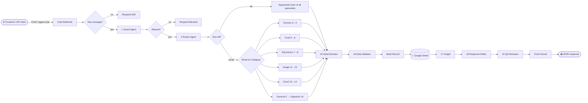
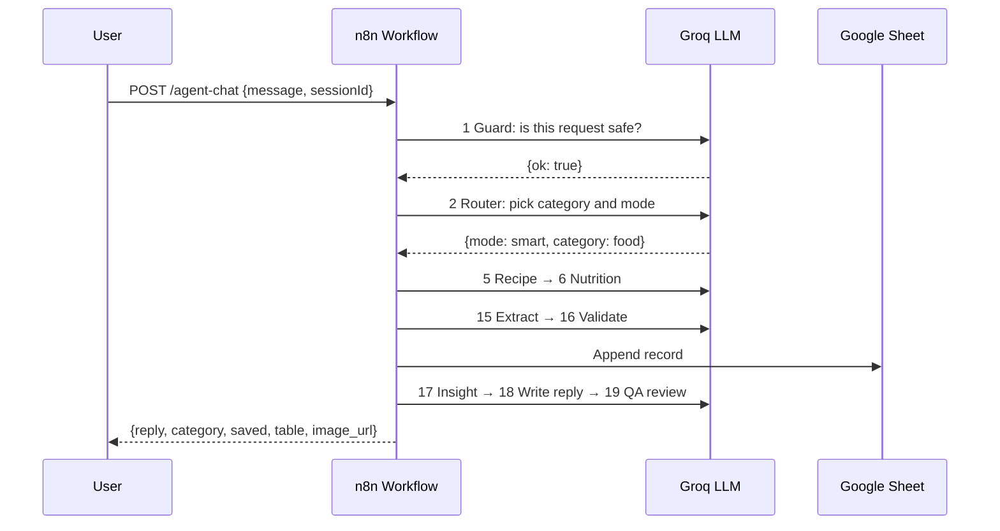

# Multi-Agent-AI-Workflow-Automation-System
# 🤖 Multi-Agent AI Workflow Automation System

### 🚀 One chat box, 20 specialist AI agents: routing, safety guard, QA review, Google Sheets logging and a live dashboard, all built in n8n


> 💬 User message → 🛡️ Guard → 🧭 Router → 🤖 Specialist agent chain → 🗂️ Extract & validate → 📄 Save to Sheet → 💡 Insight → ✍️ Reply → ✅ QA review → 📤 Response

A multi-agent automation platform that turns a single chat message into a complete, reviewed and logged result. An n8n workflow with **20 AI agents**, all powered by Groq-hosted `openai/gpt-oss-120b`, safety-checks every request, routes it to the right specialists (grocery, food, electronics, image, Excel, general), structures the answer, saves it to Google Sheets, and returns a polished reply. A second webhook powers a live analytics dashboard.

---

## 📚 Table of Contents

- [✨ Features](#-features)
- [🏗️ Architecture](#️-architecture)
- [🔄 Request Lifecycle](#-request-lifecycle)
- [🤖 The 20 Agents](#-the-20-agents)
- [🧰 Tech Stack](#-tech-stack)
- [📁 Project Structure](#-project-structure)
- [⚡ Quick Start](#-quick-start)
- [🔌 API Endpoints](#-api-endpoints)
- [🧪 Run All Agents Mode](#-run-all-agents-mode)
- [📊 Dashboard](#-dashboard)
- [🔑 Required Credentials](#-required-credentials)
- [🗺️ Roadmap](#️-roadmap)
- [🛟 Troubleshooting](#-troubleshooting)
- [📄 License](#-license)

---

## ✨ Features

| | Feature | Description |
|---|---|---|
| 🛡️ | **Safety guard** | Agent 1 blocks illegal, harmful or abusive requests before anything else runs |
| 🧭 | **Smart router** | Agent 2 classifies each message into grocery, food, electronics, image, excel, organizer, other or all |
| 🤝 | **Specialist chains** | Each category runs a two-agent pipeline: a specialist drafts, a second agent refines |
| 🧪 | **Run-all mode** | One message can trigger every specialist agent in sequence |
| 🗂️ | **Data extraction** | Agents 15 and 16 turn free text into validated JSON: title, details, tags, table, image prompt |
| 📄 | **Google Sheets logging** | Every result is saved as a row: timestamp, category, title, details, extra, image URL, table |
| 🖼️ | **Image generation** | Final image prompts become Pollinations image URLs |
| ✅ | **QA review** | Agent 19 fact-checks and polishes the reply before it is sent |
| 📈 | **Live dashboard** | Agent 20 summarises activity with counts, recent rows and an AI insight |
| 🌐 | **Web frontend** | `everything-desk.html` talks to the webhooks, with CORS enabled |
| 🚦 | **Rate-limit friendly** | Wait nodes space out Groq calls to avoid 429 errors |

---

## 🏗️ Architecture



<details>
<summary>📟 ASCII version</summary>

```
Chat Webhook → Has Message? → 1 Guard → Allowed? → 2 Router → Parse Route → Run All?
                                                                              │
                         ┌────────────────────────────────────────────────────┤
                         │ all                                                │ smart
                         ▼                                                    ▼
          3→4→5→6→7→8→11→12→13→14→9                               Route by Category
                         │                                  ┌────┬────┬────┬────┬────┬────┐
                         ▼                                  3→4  5→6  7→8 11→12 13→14  9
                  Combine Outputs                            │    │    │    │    │    │
                         │                                   └────┴────┴────┴────┴────┘    ▼
                         ▼                                              15 Data Extractor  10 Organizer
                   10 Organizer ────────────────────────────────────────────▶ 15 Data Extractor
                                                                              │
15 Extractor → 16 Validator → Build Record → Google Sheet → 17 Insight → 18 Writer → 19 QA → Respond
```

</details>

---

## 🔄 Request Lifecycle



<details>
<summary>📟 Text version</summary>

```
1. Webhook receives {message, sessionId}
2. Empty message  → 400 "Type a message first."
3. Guard blocks   → reply with the reason
4. Router returns {mode, category}
5. mode = all     → every specialist runs in sequence
   mode = smart   → the matching specialist pair runs
6. Extractor + Validator produce clean JSON
7. Record is appended to Google Sheets
8. Insight → Response Writer → QA Reviewer
9. Final JSON is returned to the caller
```

</details>

---

## 🤖 The 20 Agents

| # | Agent | Role |
|---|---|---|
| 1 | 🛡️ **Guard** | Safety and intent check, returns `{ok, reason}` |
| 2 | 🧭 **Router** | Returns `{mode, category}` as JSON |
| 3 | 🛒 **Grocery Planner** | Shopping list grouped by aisle with quantities |
| 4 | 💰 **Grocery Budget** | Price estimates, total and 2 savings swaps |
| 5 | 🍳 **Recipe** | Recipe or meal idea with ingredients and steps |
| 6 | 🥗 **Nutrition** | Calories, macros and allergen notes (estimates) |
| 7 | 🔌 **Electronics Specs** | Explains the specs that matter, never invents exact specs |
| 8 | 🎯 **Electronics Advisor** | Buying recommendation with trade-offs and 3 criteria |
| 9 | 💬 **General** | Concise answers to everything else |
| 10 | 🗒️ **Organizer** | Turns drafts into a prioritized action list |
| 11 | 🖼️ **Image Prompt** | Detailed image-generation prompt |
| 12 | 🎨 **Image Style** | Final prompt of up to 60 words with style keywords |
| 13 | 📊 **Excel Schema** | Spreadsheet columns, types and 8 sample rows |
| 14 | ➗ **Excel Formula** | Totals, averages and formulas with cell references |
| 15 | 🗂️ **Data Extractor** | Free text → JSON `{title, details, extra, image_prompt, table}` |
| 16 | 🔧 **Data Validator** | Repairs JSON, fixes row and column counts |
| 17 | 💡 **Insight** | One short insight or next step, max 25 words |
| 18 | ✍️ **Response Writer** | Friendly reply of up to 150 words |
| 19 | ✅ **QA Reviewer** | Fact-checks and polishes the final reply |
| 20 | 📈 **Dashboard Analyst** | Summarises sheet activity for the dashboard |

### 🧭 Routing categories

| Category | Pipeline |
|---|---|
| `grocery` | 3 Planner → 4 Budget → Extractor |
| `food` | 5 Recipe → 6 Nutrition → Extractor |
| `electronics` | 7 Specs → 8 Advisor → Extractor |
| `image` | 11 Prompt → 12 Style → Extractor |
| `excel` | 13 Schema → 14 Formula → Extractor |
| `organizer` / `other` | 9 General → 10 Organizer → Extractor |
| `all` | Every specialist in sequence, then Organizer → Extractor |

---

## 🧰 Tech Stack

| Layer | Technology |
|---|---|
| ⚙️ Orchestration | n8n (webhooks, IF, Switch, Code, Wait, Google Sheets nodes) |
| 🤖 Agents | n8n AI Agent nodes (LangChain) |
| ⚡ LLM | Groq `openai/gpt-oss-120b`, temperature 0.3 |
| 📄 Storage | Google Sheets (append and read) |
| 🖼️ Images | Pollinations image URLs |
| 🌐 Frontend | Plain HTML, CSS and JavaScript (`everything-desk.html`) |
| 🔐 Access | Webhooks with CORS enabled |

---

## 📁 Project Structure

```
Multi-Agent-AI-Workflow-Automation-System/
├── 🌐 everything-desk.html        # chat + dashboard frontend
├── 🤖 workflows/
│   └── everything-desk.json       # n8n workflow export (import this)
├── 🖼️ docs/
│   └── workflow.png               # screenshot of the n8n canvas
└── 📖 README.md
```

> 💡 Add the exported workflow JSON under `workflows/` so anyone can import it with one click.

---

## ⚡ Quick Start

### 1. Get the code

```bash
git clone https://github.com/Vaibhavsable451/Multi-Agent-AI-Workflow-Automation-System.git
cd Multi-Agent-AI-Workflow-Automation-System
```

### 2. Run n8n

```bash
# Option A: Docker
docker run -it --rm -p 5678:5678 -v n8n_data:/home/node/.n8n docker.n8n.io/n8nio/n8n

# Option B: npx
npx n8n
```

Open <http://localhost:5678>.

### 3. Import the workflow

1. In n8n choose **Workflows → Import from File**
2. Select `workflows/everything-desk.json`

### 4. Add credentials

| Credential | Used by |
|---|---|
| **Groq API** | `Groq Chat Model` and `Groq Chat Model1` |
| **Google Sheets OAuth2** | `Save to Google Sheet`, `Read Sheet Rows` |

### 5. Prepare the Google Sheet

Create a sheet with this header row, then select it in both Google Sheets nodes:

```
timestamp | category | title | details | extra | image_url | table_json
```

### 6. Activate and open the frontend

1. Toggle the workflow to **Active**
2. Point the webhook URLs in `everything-desk.html` at your n8n instance
3. Open `everything-desk.html` in a browser

---

## 🔌 API Endpoints

| Method | Path | Description |
|---|---|---|
| `POST` | `/webhook/agent-chat` | 💬 Send a message through the full agent pipeline |
| `GET` | `/webhook/agent-dashboard` | 📈 Counts, recent rows and an AI insight |

> 🧪 While building, use `/webhook-test/...` and click **Execute workflow** in n8n first.

### 💬 Chat request

```bash
curl -X POST http://localhost:5678/webhook/agent-chat \
  -H "Content-Type: application/json" \
  -d '{"message": "Plan a vegetarian dinner for 4", "sessionId": "demo-1"}'
```

### 📤 Chat response

```json
{
  "reply": "Friendly, QA-reviewed answer saved to your sheet...",
  "category": "food",
  "saved": { "title": "Vegetarian Dinner for Four", "details": "..." },
  "table": null,
  "image_url": "",
  "timestamp": "2026-10-30T07:06:00.000Z",
  "agent_outputs": null
}
```

| Status | Meaning |
|---|---|
| `200` | Normal reply, or a block reason if the guard refused |
| `400` | Empty message, replies "Type a message first." |

---

## 🧪 Run All Agents Mode

Ask for every agent at once and include a topic so each specialist has something to work on:

```
Run all agents: plan a birthday dinner for 6 people
```

| Step | What happens |
|---|---|
| 1 | The Router returns `{"mode":"all","category":"all"}` |
| 2 | **Run All?** sends the request into the sequential chain: 3 → 4 → 5 → 6 → 7 → 8 → 11 → 12 → 13 → 14 → 9 |
| 3 | A 3-second **All Wait** between stages keeps Groq under its rate limit |
| 4 | **Combine Outputs** gathers every specialist's answer |
| 5 | The Organizer merges them, then the normal Extract → Validate → Save → Reply → QA path runs |
| 6 | The response includes `agent_outputs`, the full output of each agent |

---

## 📊 Dashboard

`GET /webhook/agent-dashboard` reads the sheet and returns:

```json
{
  "counts": { "food": 12, "grocery": 7, "excel": 4 },
  "total": 23,
  "rows": [ "...latest 60 records, newest first..." ],
  "insight": "Two short sentences on activity plus one suggested next action."
}
```

---

## 🔑 Required Credentials

| Credential | Where to get it |
|---|---|
| `GROQ_API_KEY` | <https://console.groq.com/keys> |
| Google OAuth client | Google Cloud Console → enable the Sheets API |

> ⚠️ Never commit API keys or exported credentials. n8n exports contain credential references only, but check the Google Sheet ID before sharing it publicly.

---

## 🗺️ Roadmap

- [ ] 🧠 Per-session memory using `sessionId`
- [ ] 🌊 Streaming responses
- [ ] 🔀 Parallel run-all mode with a Merge node
- [ ] 🌍 Multi-language replies
- [ ] 🔐 Webhook authentication (header token)
- [ ] 🗃️ Database storage option (Postgres or Supabase)
- [ ] 📧 Email and Slack delivery of results

---

## 🛟 Troubleshooting

| Problem | Fix |
|---|---|
| 🔀 Only **General Agent** runs for "run all" | The Switch has no `all` output. Use the **Run All?** node from the fixed workflow |
| ⏳ Workflow hangs at a Wait node | Wait nodes default to 1 hour. Set them to a few seconds |
| 🚦 Groq `429 Too Many Requests` | Increase the Wait durations or reduce agents per run |
| 🔑 Groq errors | Check the Groq credential and model name `openai/gpt-oss-120b` |
| 📄 Nothing saved to the sheet | Check Google credentials, the sheet and the header row |
| 🌐 CORS errors in the browser | Keep `allowedOrigins: *` on the webhooks and the CORS header on Respond nodes |
| 🧪 404 on webhook | Activate the workflow for `/webhook/...`, or run it once for `/webhook-test/...` |
| ✂️ Short replies in run-all mode | The extractor caps details at 1000 chars. Read `agent_outputs` for full text |

---

## 📄 License

MIT. See [LICENSE](LICENSE).

---

⭐ If this project helps you, give it a star! ⭐
